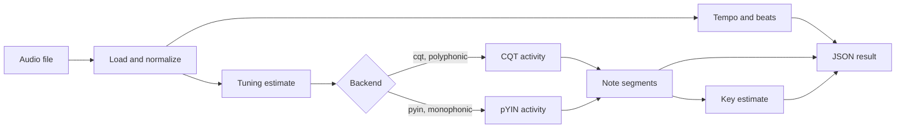
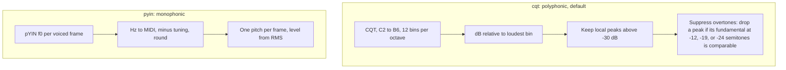
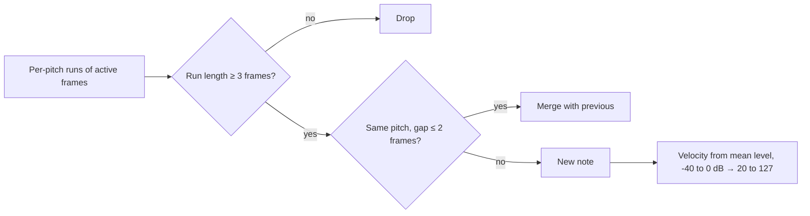
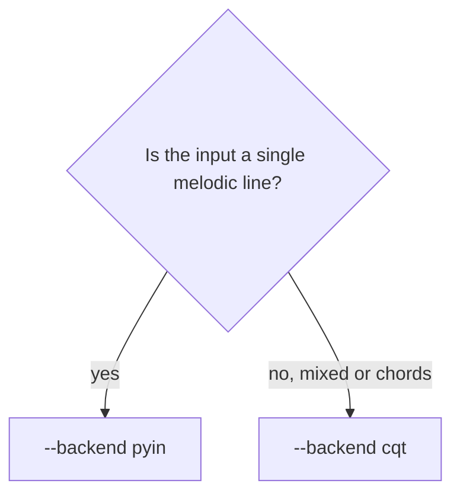
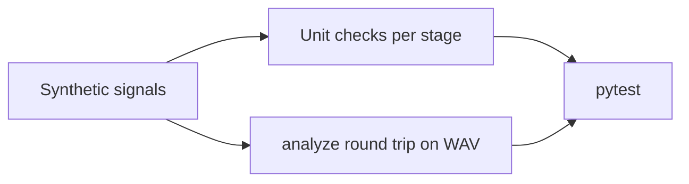

# Audio Pipeline

The pipeline turns an audio file into tempo, a list of notes (with pitch class and octave), and a key/tonic estimate. It lives in `pipeline/`.

## At a glance



## Stages

| # | Stage | What it does | Key function |
|---|---|---|---|
| 1 | Load | Mono, resample to 22.05 kHz, peak-normalize | `load_audio` |
| 2 | Tuning | Deviation from A440 in semitones | `estimate_tuning` |
| 3 | Tempo | Onset envelope, beat tracking, BPM from median beat gap | `estimate_tempo` |
| 4 | Activity | Which MIDI pitch is sounding in each frame | `cqt_activity` or `pyin_activity` |
| 5 | Segments | Turn frame activity into notes with onset, offset, velocity | `notes_from_activity` |
| 6 | Key | Duration-weighted pitch-class histogram vs. 24 key profiles | `estimate_key` |

### Stage 4: two backends



### Stage 5: from frames to notes



### Stage 6: key estimate

Each pitch class is weighted by total note duration. The histogram is correlated with the Krumhansl–Kessler major and minor profiles, rotated to all 12 tonics. The best match is the key. `margin` is the gap between the best and second-best correlation. A small margin means the answer is uncertain.

## Output

```json
{
  "file": "tests/scale.wav",
  "backend": "cqt",
  "sample_rate": 22050,
  "duration_s": 7.5,
  "tuning_semitones": 0.01,
  "tempo": {"bpm": 120.2, "confidence": 1.0, "alternatives": {"half": 60.1, "double": 240.4}, "beat_times": [...]},
  "key": {"tonic": "C", "mode": "major", "correlation": 0.866, "margin": 0.101},
  "notes": [
    {"onset": 0.0, "offset": 0.511, "midi": 60, "pitch_class": "C", "octave": 4, "velocity": 125}
  ]
}
```

Octave uses scientific pitch notation: C4 = MIDI 60. MIDI = 69 + 12·log₂(f / 440), shifted by the tuning offset.

## Choosing a backend



## Parameters

All tunable values are module constants in `pipeline/analyze.py`:

| Constant | Value | Effect |
|---|---|---|
| `SR` | 22050 | Sample rate |
| `HOP` | 512 | Frame hop (≈23 ms) |
| `CQT_MIDI_MIN`, `CQT_BINS` | 36, 60 | Pitch range, C2 to B6 |
| `CQT_THRESH_DB` | -30 | Peak threshold relative to the loudest bin |
| `MIN_NOTE_FRAMES` | 3 | Shortest note (≈70 ms) |
| `MERGE_GAP_FRAMES` | 2 | Largest gap bridged within one note |

## Known limits

- The key estimate is Western. It does not model Carnatic Sa or raga.
- Octave doublings at similar loudness can be dropped by overtone suppression.
- Tempo assumes a steady beat. Rubato or changing tempo will lower `confidence`.
- Tuning is estimated per file, not per note.

## Tests

`pytest tests/` runs synthetic-signal tests: pitch, tuning, tempo from clicks, key from a C major scale and an A minor histogram, and a WAV round trip. `tests/scale.wav` and `tests/scale.json` are a sample input and its expected output.


